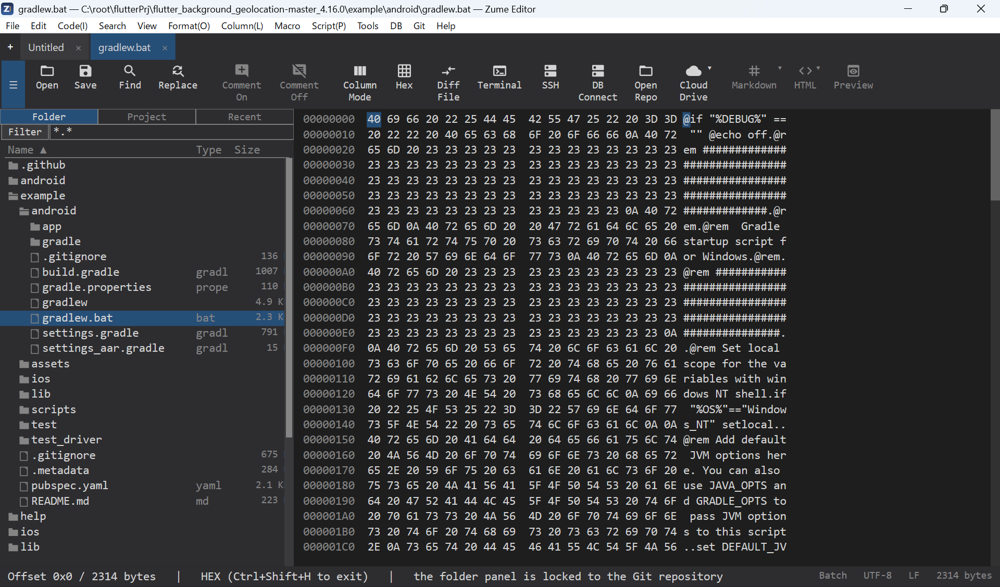
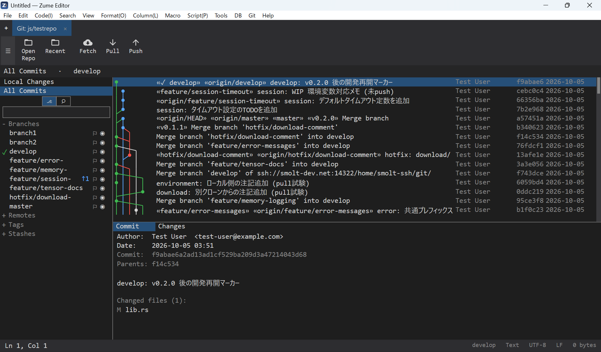
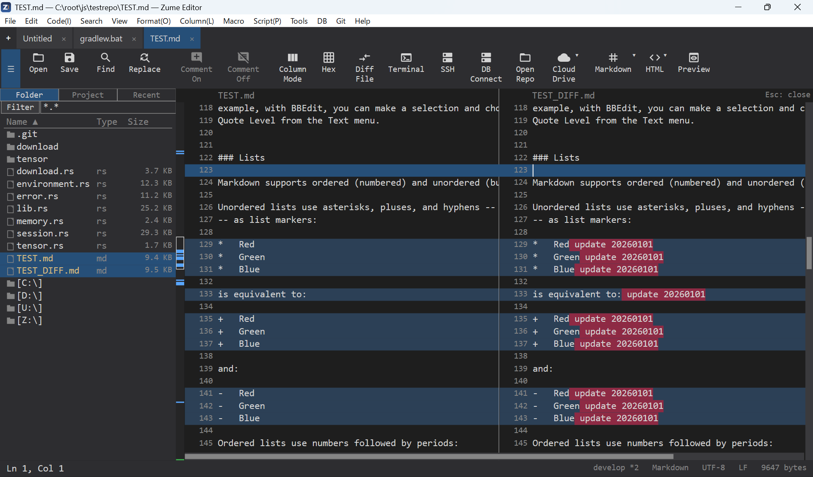
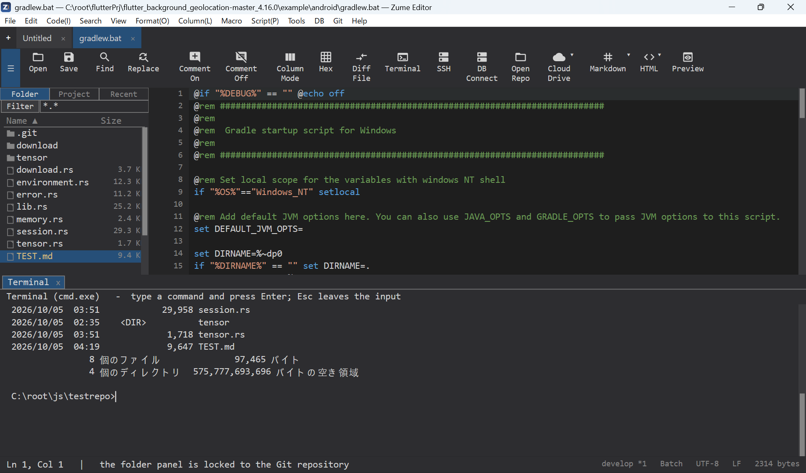
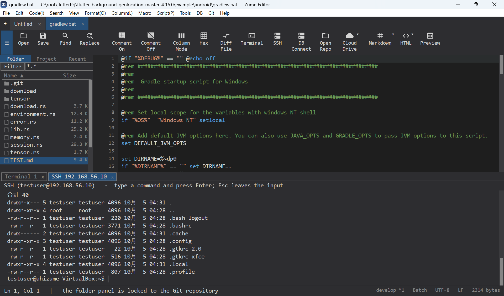
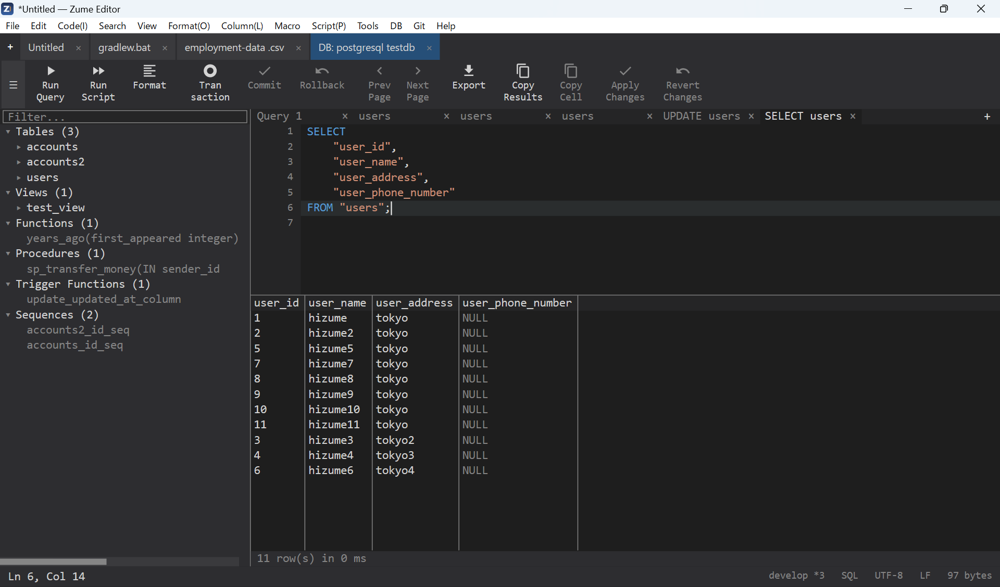
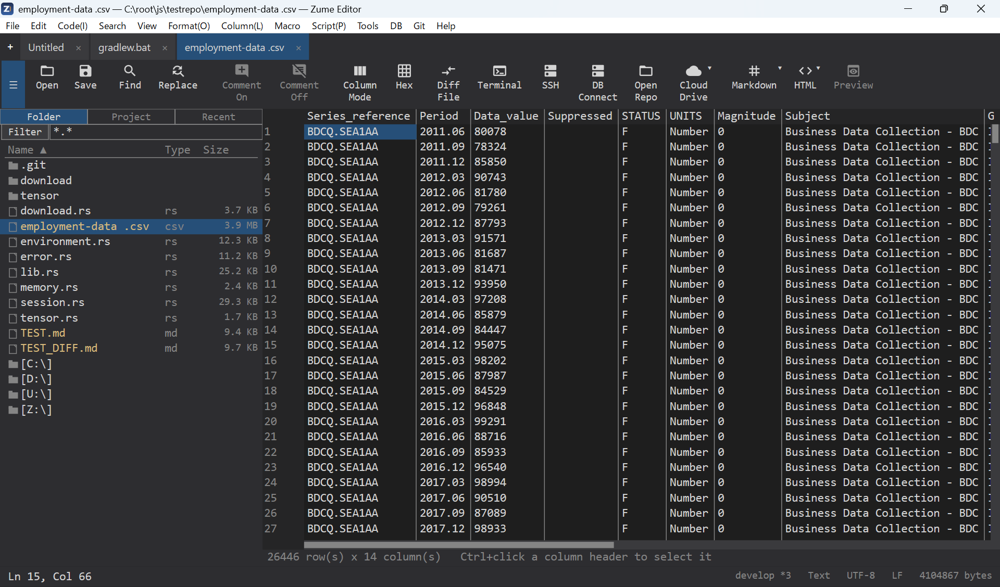
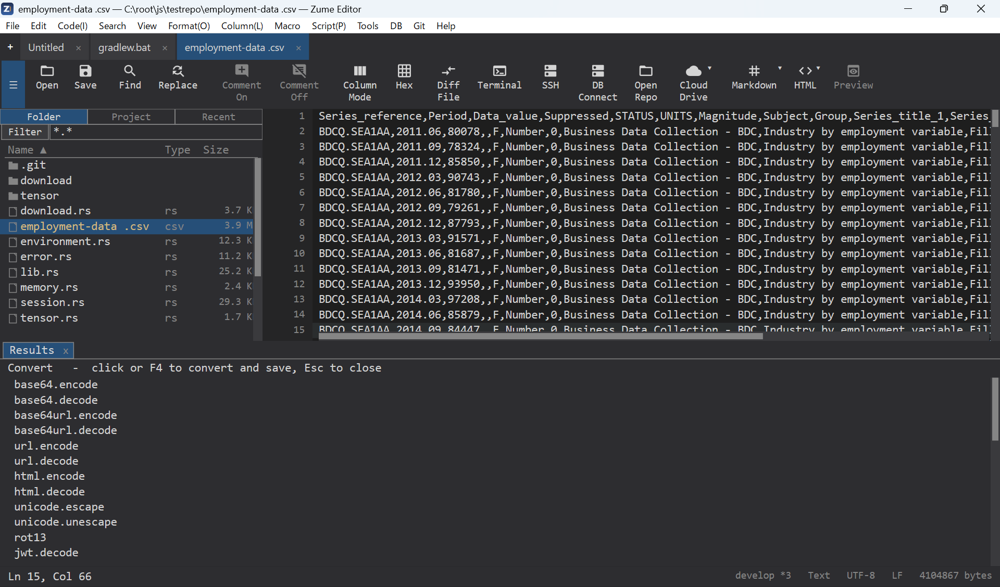
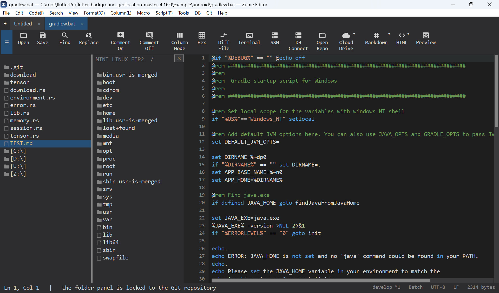

# Zume Editor

**A fast, native text / code / hex editor for Windows, macOS and Linux — built in C++.**
Open 10GB+ files instantly, and get a hex editor, a Git client, a terminal, SSH/SFTP, database tools, diff/merge, CSV editing, format conversion, a CLI and an MCP server — all in one app.

> 🧪 **Free public beta.** All features are free to use until **2027-03-31**. A subscription is planned for the stable release.

➡️ **[Download for Windows / macOS / Linux](https://smolt-stage.com/home/en/download.html)** · [Help & docs](https://zume-editor-dev.github.io/zume-editor-help/) · [Report an issue / request a feature](https://github.com/zume-editor-dev/zume-editor-help/issues)

## Why Zume

Stop juggling a separate viewer for huge logs, a hex editor, a Git client, an SFTP tool, a DB client and a diff tool. Zume puts them in **one lightweight native app**, with the same UI and a shared undo — and it stays responsive even on multi-gigabyte files.

## Highlights

- **Very large files** — a memory-mapped + piece-table engine opens, searches, edits and saves 10GB+ files without loading them into RAM. Near-instant first view and smooth scrolling.
- **Hex editor** — offset / ASCII / EBCDIC columns, byte find & replace, undo shared with the text view.
- **Git client** — stage/commit, branches, a log graph, diffs, conflict resolution, fetch / pull / push.
- **Terminal, SSH & remote editing** — a built-in terminal, an SSH shell, and remote files over SFTP / FTP / FTPS.
- **Database tools**, **two-pane diff & merge**, **CSV grid editing**.
- **Format conversion** (encodings, line endings, geo data…), a **CLI mode**, and an **MCP server** for AI agents.
- **Everyday editing** — syntax highlighting, code folding, outline, multi-caret, column mode, search/replace, split view, session restore.
- **Native on each OS** — Direct2D/DirectWrite (Windows), Core Text (macOS), GTK4/Pango (Linux).

## A look around

| Hex editor | Git client |
|---|---|
|  |  |

| Diff & merge | Terminal |
|---|---|
|  |  |

| SSH / remote | Database tools |
|---|---|
|  |  |

| CSV grid editing | Markdown preview |
|---|---|
|  |  |

| Format conversion | Cloud / FTP |
|---|---|
|  |  |

## Download

Get the latest build from the **[download page](https://smolt-stage.com/home/en/download.html)** or the **[Releases](https://github.com/zume-editor-dev/zume-editor-releases/releases/latest)**:

| OS | Format |
|----|--------|
| **Windows 10/11 (x64)** | Portable ZIP — no installer, just unzip and run |
| **macOS (Apple Silicon)** | DMG — signed & notarized (launches without warnings) |
| **Linux (x86_64)** | AppImage / DEB / RPM |

Verify your download against `SHA256SUMS.txt` on the release.

> **Windows first run:** the beta is not code-signed yet, so SmartScreen may warn — choose **More info → Run anyway**. (The stable release will be signed.)

## Beta & licensing

- This is an early **public beta**; all features are **free to use until 2027-03-31** (the build stops working after that date).
- The stable release will be a **subscription**. One license will cover Windows, macOS and Linux.
- Your feedback shapes the 1.0 — please [open an issue](https://github.com/zume-editor-dev/zume-editor-help/issues) with your OS, the app version, and steps to reproduce. On Windows, the log is at `%LOCALAPPDATA%\ZumeEditor\logs\zume-editor.log`.

## Links

- Website: https://smolt-stage.com/home/en/zume-editor.html
- Help & docs: https://zume-editor-dev.github.io/zume-editor-help/
- Feedback: https://github.com/zume-editor-dev/zume-editor-help/issues

---

© 2026 SMOLT STAGE, K.K. Zume Editor is a product of SMOLT STAGE, K.K.
